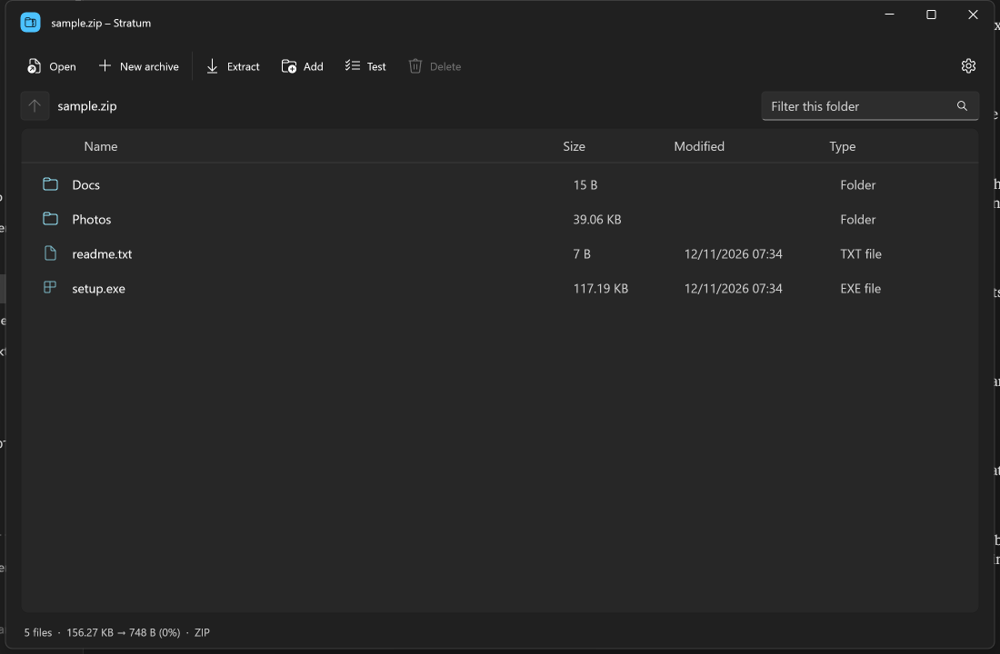

# Stratum

A modern archive manager for Windows, built with WinUI 3 and the 7-Zip engine.



## What it does

| | |
|---|---|
| **Create** | ZIP, 7Z, TAR |
| **Open and extract** | ZIP, 7Z, TAR, RAR / RAR5, plus GZ, BZ2, XZ, CAB, ISO, WIM and the other formats 7-Zip reads |
| **Encryption** | AES-256 passwords for ZIP and 7Z; 7Z can also hide file names |
| **Split archives** | Create `name.zip.001`, `.002`, … at any size; open split and multi-part archives |
| **Edit** | Add files to, and delete files from, ZIP / 7Z / TAR archives |
| **Integrity** | Test an archive for damage |
| **Drag and drop** | Drop an archive to open it, drop files to compress or add them, drag items out to Explorer |
| **Explorer** | Right-click menu: open, extract here, extract to a new folder, add to archive |
| **Look** | Fluent design with Mica, light / dark / system theme |

RAR archives are extract-only. The RAR format is proprietary and its licence does not allow
third-party tools to create RAR files.

## Build

Requirements: Windows 10 2004 or later (x64), the [.NET 9 SDK](https://dotnet.microsoft.com/download),
and Visual Studio 2022 or Build Tools with the **Desktop development with C++** workload and a Windows SDK.

```powershell
.\build.ps1 -Test
```

This runs the tests and writes a self-contained app to `artifacts\Stratum`. Start `artifacts\Stratum\Stratum.exe`.

## Explorer integration

There are two ways to get the right-click menu:

- **Classic menu, no setup.** In Stratum, open the settings menu (gear icon) and turn on
  *Show in Explorer right-click menu*. It is registered for your user only. On Windows 11 the
  entries appear under *Show more options*.
- **Windows 11 modern menu.** Windows 11 only lists apps that have a package identity, so this
  needs a one-time, elevated step that signs and registers a small package pointing at the
  build output:

  ```powershell
  .\packaging\Register-ContextMenu.ps1
  ```

  The script creates a self-signed development certificate and trusts it on your PC. Read the
  header of the script before running it. `Unregister-ContextMenu.ps1` undoes it.

## Command line

```
Stratum.exe archive.zip                    open
Stratum.exe --extract-here a.zip [b.7z …]  extract next to each archive
Stratum.exe --extract-to a.zip [b.7z …]    extract each into a folder named after it
Stratum.exe --add file-or-folder […]       open the New archive dialog for these items
```

## Layout

```
src/Stratum.Core       archive engine: read, extract, create, modify (no UI)
src/Stratum.App        WinUI 3 application
src/Stratum.ShellExt   C++ IExplorerCommand for the Windows 11 context menu
packaging/             sparse package manifest and registration scripts
tests/                 xUnit tests for the engine
third_party/7zip       7z.dll and its licence
```

Extraction is staged: files are unpacked into a temporary folder inside the destination and
moved into place only after every path has been checked, so an archive cannot write outside the
folder you chose, and a failed or cancelled run leaves nothing half-written.

## Not included yet

Repair and recovery records, self-extracting archives, creating TAR.GZ in one step, and file
associations are not implemented.

## Credits

Compression is provided by [7-Zip](https://www.7-zip.org) (`7z.dll`), © Igor Pavlov, under the
GNU LGPL with the unRAR restriction (see `third_party/7zip/License.txt`), accessed through
[SevenZipSharp](https://github.com/squid-box/SevenZipSharp). Stratum is an independent project and
is not affiliated with 7-Zip, RARLAB or WinRAR.
